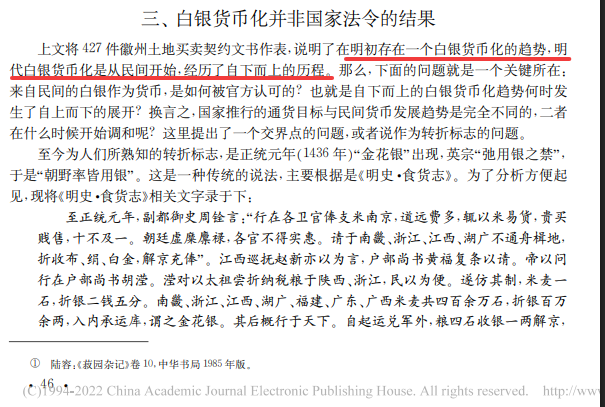
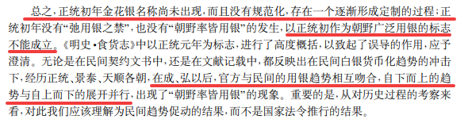
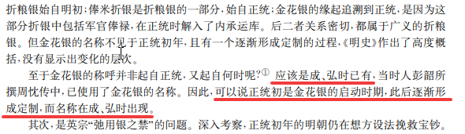
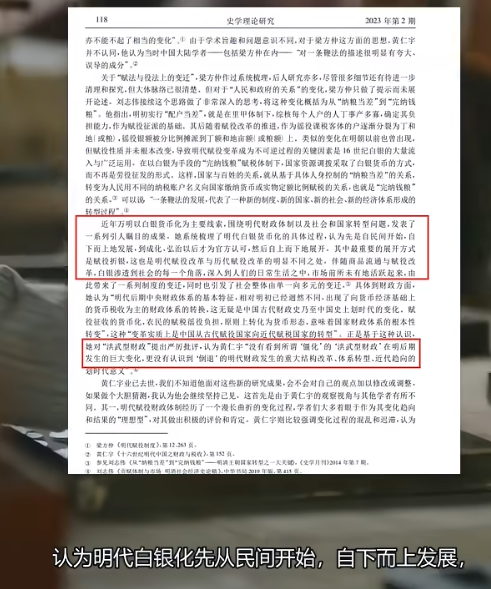
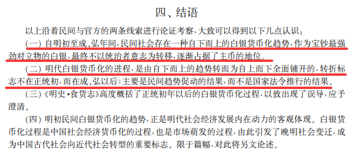
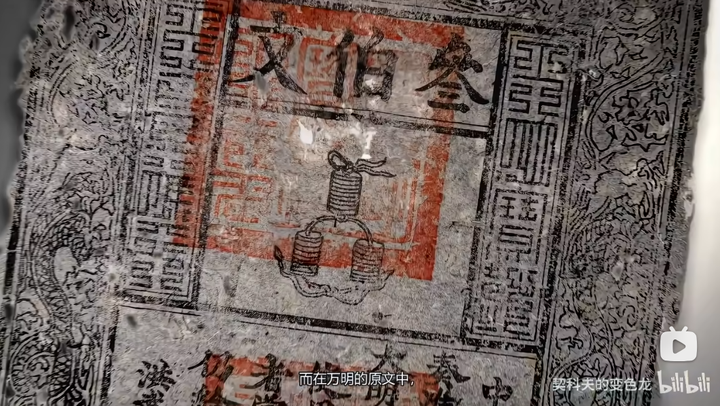
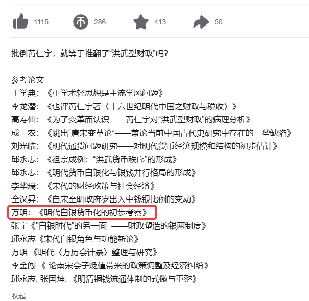

# 高寿仙“造谣”万明？——驳“契科夫的变色龙”B站视频的“辟谣式造谣”

@契科夫的变色龙 契科夫的变色龙（以下简称契色龙）11月13号在B站发的视频《批倒黄仁宇，就推翻了“洪武型财政”?明史研究还在螺蛳壳里做道场，故纸堆里摘文章?》，视频中出现了明显的事实错误，而在我本人审查回复之后，对方迅速**删评拉黑一条龙**。似乎此君眼中留不得一粒沙子，故留此贴，以正视听，欢迎转载。

先举出视频中有误的部分，08：08开始：

“而明粉引用高寿仙的那篇**《为了变革而认识——黄仁宇对洪武型财政的病理分析》**更是漏洞百出，随便举个例子，高寿仙在论文中转述万明相关研究时提到，万明以白银货币化为主要线索，认为明代白银化先从民间开始，自下而上发展，到成化、弘治以后才为官方认可，这就是纯粹的造谣，而在万明的原文中，首先是介绍了洪武宝钞发行失败，洪武禁钱令，以及后续朱棣时期延续的禁令……”

契色龙大意是说，高寿仙在论文中“造谣”万明认为明代白银化“先从民间开始，自下而上发展”，而“造谣”意味着万明原文没有得出这样的结论。

这就是典型的“辟谣式造谣”，因为但凡只要看完**《明代白银货币化的初步考察》**这篇13页的小论文，就知道引用是完全成立的——万明在论文后半部分基本强调与“谣言”完全一样的话，并且在结语下了明确的结论，详见：

第三节开篇言明了“先从民间开始，自下而上发展”这一论点

对于高寿仙“成化、弘治以后才为官方认可”也有明确出处

成、弘时白银货币化才成为定制的证据

“金花银”是万明锚定“来自民间的白银何时被官方认可”的关键点，“名称在成、弘时出现”理解作成、弘时白银货币化已成定制得到官方认可，这样说也没有什么问题，不过万明在后续也很谨慎地说，至少官方认可不在正统初年。

正统初年白银货币化被官方自上而下展开不成立

诶，看到最后一条划线文本有人要说了，万明这不也讲了存在“自上而下的展开”吗？契色龙不是也说“真正决定明朝单一白银货币化的是自上而下的力量……而不是高寿仙所说的所谓自下而上”。好吧，这里要讲一个更油墨的事情，那就是**契色龙其实断章了高寿仙论文那段话（引文）**，如果不断章取义，那段话本来就是“先从民间开始，自下而上发展，然后再自上而下展开”，本来就是和万明原文一致的。他自己配图里还画了红框框起来的，真当观众都是瞎子啊？

（以防看不清指路视频08：17，要怪就怪牢契上传720p）

接下来我们放万明论文结语，绝杀：

结语（一）（二）给出了明确结论

那么总结一下，幽默牢契这个随口的举例指责出现了哪些错误点：

高寿仙对万明的引用实际上没有问题，文本和意思都高度一致，绝非造谣；而契色龙的指责则纯属”辟谣式造谣”。

契色龙对高寿仙的引文进行了断章取义，没有提到高和万对“自上而下展开”本就有所承认，反而试图包装成自己对高的批评性观点。

实质上最严重的问题，涉及契色龙的诚信或能力问题。结合2我们可知，契色龙疑似在阅读这篇“明粉文章”时有睁眼说瞎话的毛病，下述两个疑点让这个问题更加显著：其一，契色龙声称高寿仙“造谣”的重要依据是“而在万明的原文中”，上一秒他批高寿仙时明确放了高论文那张有红框框的图，下一秒不应该配万明论文原文吗，然后他配的图是这样的：

幽默配图，论文原文怎么不继续放了

为什么不随便找张万明的原文呢，你不是也补充她说了“首先…以及…”嘛，完全可以像挑高寿仙刺一样，拿红框框标注一下嘛。

不过，这里我突然怀疑有没有可能牢契其实找了和我不一样的论文，毕竟万明写了那么多篇白银货币化，自然他没有发现我所看到的内容呢。因此，牢契第二个疑点，很可能，他完全知道自己在看什么：

自己参考的文献你自己不看？

是的，他在参考文献里明确列出，看的“万明原文”就是这一篇文章。

好的，现在试想一位本科生给他的论文导师呈上了像这样的一部“大作”，当导师皱着眉头看了看他的荒唐正文和堂堂正正脚注的参考文献，他会怎样？

导师一定会问他两个问题：

你到底读没读过你自己引用的东西？你是否具备基本的文献检索、阅读理解能力？

其实你读过了这篇文章，但你为了强撑你自己的观点，故意歪曲、掩盖、忽略了原文内容，赌你的读者不知道这回事，是吧？

问完这两个问题之后，结局基本只有一个。

导师：打回去，重做。

其实我本来完全没想写这篇文章，也完全没想“痛批”明黑的，实际上，我早就对社媒上明清粉黑风水轮转、暴论频出的风气厌烦了。我只是无聊看看，看到视频中间段指责别人有引用漏洞时倍感诧异，一般来说，人家也不是什么硕博之流，对这种最基本的问题有异议就像在质疑参考答案——往往你是错的。然后我花了不到五分钟就定位到了别人的原文，搞清楚了问题，接着回去原视频评论。

然后我发现评论被吞了，秒吞，发一条吞一条，正当我以为又是你哔司冯阿瓦隆机制发作时，下面终于显示，哦，原来我是被删评拉黑了啊。

好吧，这下我对你们这些社媒活跃的“史论导师”又有了更新的认识：高度控评，不容意见，缩头乌龟。

现在，再回来谈你的那两个问题，如果你其实能力有限，根本没注意到万明那篇论文后半部分清晰的结论，那么在建议你提升阅读、检索、理解这些基本素养的同时，我还要告诉你，如果连这些“翻故纸堆”的水平都没有，你这种学术嘉豪就不要去碰瓷官科了！否则你挑别人一根刺，别人能挑你一百根刺！而假如，就像我高度怀疑的那样，你实际上是读完且清楚地知道，高寿仙的引用无误，且万明论文的观点于你相当不利，那么恳请你撤回有问题的指责，注意这并不是替高寿仙等被你实质上造谣学术污点的人讲话，而是因为对观众读者的诚信是非常重要的事情，是因为不诚信迟早反噬、塌房！

最后申明，我只是在茶余饭后闲着看契色龙的视频，对明粉明黑并不持有什么立场，文章也是闲下来写的，花的时间不算多，万明的论文在知网是免费下载的，大家都可以去看，如有疏漏，也欢迎指正。但我不会控评，也不会事后编辑初版文本（也懒得如此），就这样。
